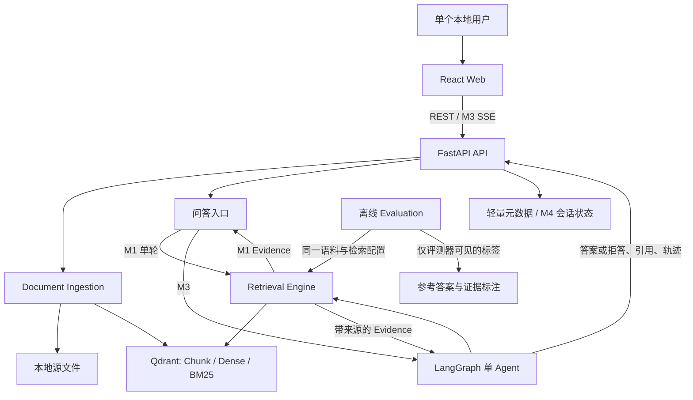

# DocScope 系统架构

> 状态：目标架构；M1/M2、DOCS-011 单轮 Run 和 DOCS-012 有界第二跳已接通，完整充分性判断、SSE 和记忆仍未实现。阶段范围与验收以 [design.md](design.md) 为准；未冻结的实现选择统一列于 [OPEN_QUESTIONS.md](OPEN_QUESTIONS.md)。

## 结构与边界

箭头表示目标数据流，不表示所有组件同时进入 M1。M1 使用 Dense 单轮路径；M2 扩展 Retrieval Engine；M3 接入 Agent 与 SSE；M4 才引入会话记忆。

## 组件职责

| 组件 | 职责 | 不承担的职责 |
|---|---|---|
| React Web | 上传、状态、提问、引用与轨迹展示；M3 消费 SSE | 检索排序、Agent 决策、保存 LLM 凭据 |
| FastAPI | 请求校验、文档/问答接口、流式事件和错误边界 | 自行决定证据充分性 |
| Document Ingestion | 解析英文文本型 PDF/Markdown 或评测文章，标准化、分块、生成本地 Embedding、更新索引与来源映射 | 将参考答案或人工证据标注写入在线索引 |
| Retrieval Engine | 对同批 Chunk 执行 Dense 与 Qdrant 全文 BM25，RRF 融合、去重、本地 Cross-Encoder 重排，返回带来源的证据 | 决定下一跳问题或最终回答 |
| LangGraph Agent [M3] | 规划缺失事实、调用 Retrieval Engine、评估证据、决定继续/停止、生成回答或拒答 | 直接读写 Qdrant 或把模型推理链公开给 UI |
| Conversation Memory [M4] | 恢复会话、维护近期消息与摘要、改写追问 | 将摘要当作未经检索验证的事实来源 |
| Offline Evaluation | 装载冻结数据、运行 Baseline/消融、计算指标、保存逐题结果 | 向在线问答暴露参考答案和标注 |

## 文档数据流

1. API 接收受支持的源文件，校验类型、大小与路径；记录导入状态。
2. Ingestion 提取可定位原文，标准化后分块。每个 Chunk 关联 `document_id`、`chunk_id`、源位置和索引版本；PDF 页码、Markdown 章节在可用时保留。
3. 本地 Embedding 模型生成 Dense 向量；原文与向量写入 Qdrant。同一批 Chunk 在 M2 加建原生全文 BM25 索引，不维护第二套 BM25 数据库。
4. 同一文档重传代表替换，不建立版本历史；重复导入不得产生重复 Chunk。删除后旧内容不再可检索。旧引用失效时前端明确提示，不指向新内容。
5. 解析、Embedding 或索引失败时，文档不得显示为可用；可诊断状态和重试/恢复方式由 M1 Issue 确定。

DOCS-007 已冻结文档状态的 SQLite 持久化、替换可见性、Chunk 身份和恢复行为，参见[生命周期合同](document-lifecycle.md)。长度/重叠分块仍须以可定位引用和开发集结果验证。

## 问答数据流

1. M1 接收单个独立问题，执行 Dense 检索并基于实际返回的 Chunk 生成回答与引用。
2. M2 在同批 Chunk 上增加 BM25、RRF 和 Reranking；候选量、重排量及注入上下文长度均受限。
3. M3 的单 Agent 识别缺失事实，执行检索、合并证据、评估覆盖情况；只有预算允许且有新检索目标时继续。后续查询须能依据前跳新事实改变。
4. 程序控制检索/模型/上下文预算、重复查询与无新证据停止、引用 ID 合法性；LLM 评估哪些必要事实仍缺失。证据不足时拒答并记录停止原因。
5. API 将文本、阶段、引用、完成或错误事件经 SSE 发送到 Web；UI 展示实际引用与简要轨迹。一个独立问题由 `run_id` 关联事件和评测记录。
6. M4 才加载 `thread_id` 对应历史，进行近期窗口、增量摘要与查询改写；本轮暂态在下一轮前重置，事实性回答仍重新检索文档。

**Assumption**：初始最多三轮检索、固定候选上限和摘要阈值只是设计默认值，必须在对应阶段评测后冻结。SSE 的断连、重试与幂等语义尚未确定。

## 存储、来源与信任边界

- **Qdrant** 保存可检索 Chunk 的 Dense 向量、原文 payload、BM25 全文索引和来源元数据。该路径要求在 M0 固定并验证支持原生全文 BM25 的版本；参见 [ADR 0001](adr/0001-qdrant-hybrid-index.md)。
- **本地文件存储** 保存上传的原始文件及必要解析产物。其内容与 Qdrant Chunk 通过稳定身份和源位置关联。
- **远程 LLM** 通过后端配置的 OpenAI-compatible URL、调用标识和模型 ID 访问。开发与正式 A–E 评测可使用外部 Magpie `group/docscope-free`；它不属于 DocScope 的内部路由层。评测冻结路由组配置，逐次记录可获得的实际模型/渠道与 Token；渠道不可辨时明确标记未知。
- **轻量状态存储** 保存导入状态；M4 的会话消息和 Checkpoint 职责边界尚未冻结。SQLite 是建议默认，不是已确认的完整数据模型。
- **外部文档是不可信输入**。检索文本不能成为系统指令；LLM 凭据只在后端，公开产物不得包含凭据、保密材料或未经许可的原始语料。
- **引用是运行时证据引用**。只有来自实际检索结果的 ID 才能进入答案；ID 合法还需与“内容支持具体结论”分开评估。参见 [ADR 0003](adr/0003-evidence-provenance-and-lifecycle.md)。

## 离线评测边界

MultiHop-RAG 的文章正文可以进入检索索引；问题参考答案、`evidence_list.fact`、不可回答标签及人工结论只进入 Evaluation。项目自行冻结开发集和封存测试集。文章级召回与支持事实片段级覆盖分别报告；无证据的 `null_query` 不进入 Recall 分母，而用于拒答评测。全部问题可运行离线检索，回答/Agent 对照使用预先固定的分层子集，以保持组间可比性；不设项目级累计金额上限。

对照同时报告实际效果与等预算 D/E 比较；检索、答案、引用、拒答、延迟和费用逐题记录。MultiHop-RAG 用于总体对照，另以人工审查样本验证第二跳依赖前跳证据。参见 [ADR 0004](adr/0004-evaluation-isolation-and-fair-comparison.md)。
